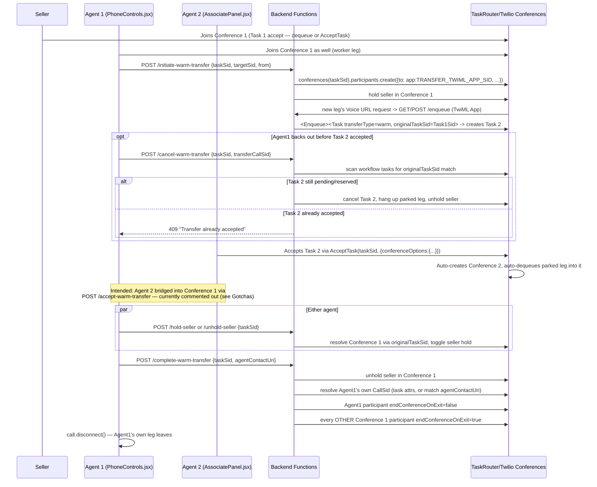

# Warm Transfer (Voice) — Technical Overview

## Scope

Covers the current, live warm-transfer implementation for voice tasks (both the `call_now` callback pattern and the plain `call_now`/dequeue pattern): `functions/functions/initiate-warm-transfer.js`, `enqueue.protected.js`, `hold-seller.js`, `unhold-seller.js`, `complete-warm-transfer.js`, `cancel-warm-transfer.js`, and the frontend wiring in `PhoneControls.jsx` (`handleWarmTransfer`/`handleCancelTransfer`/`handleToggleHold`/`handleCompleteTransfer`) and `AssociatePanel.jsx`'s `transferType === 'warm'` accept branch.

It does **not** cover cold transfer, and it does not cover three generations of now-dead warm-transfer code still sitting in the repo, kept only as reference/rollback material:
- `transfer-warm.js` — explicitly disabled by its own header comment ("DISABLED — kept for future need"), superseded by `initiate-warm-transfer.js`.
- `start-warm-consult.js` plus the old, non-`.protected` `enqueue.js`, `transfer-join-conference.js`, `leave-conference.js`, and `end-conference.js` — an earlier two-sequential-conference design. None of these are referenced from the current frontend (`grep` across `frontend/src` turns up nothing), so they appear to be dead code from a prior iteration rather than part of the live path.
- `accept-warm-transfer.js` — still wired up conceptually (referenced by comments in `hold-seller.js`/`unhold-seller.js`/`enqueue.protected.js`) but its actual REST call to bridge the target associate into the original conference is commented out; see Gotchas.

## Overview

The seller and Agent 1 (the associate who owns the call) end up together in **Conference 1**, a Flex/TaskRouter-auto-created conference named after Task 1's own SID — created either by `pendingReservation.dequeue({...})` (plain `call_now`) or by `AcceptTask(taskSid)` (the `isCallback` callback pattern), both in `AssociatePanel.jsx`.

When Agent 1 wants to bring in a second associate, `PhoneControls.jsx`'s `handleWarmTransfer` POSTs `{ taskSid, targetSid: queue.sid, from: agentContactUri }` to `initiate-warm-transfer.js`, which:
1. Adds a **new Conference Participant** to Conference 1 (`client.conferences(taskSid).participants.create({ to: 'app:<TRANSFER_TWIML_APP_SID>?taskSid=...&targetSid=...', from, earlyMedia: true, endConferenceOnExit: false })`). This new call leg's own Voice URL (rather than joining Conference 1's audio) is what actually runs next.
2. Holds the seller in Conference 1, resolving the seller's CallSid from Task 1's own `conference.participants.customer` attribute rather than guessing from the participant list.

That new leg's Voice URL is `enqueue.protected.js` (the Voice URL configured on `TRANSFER_TWIML_APP_SID`), which fetches Task 1 for its case metadata and parks the leg into the transfer workflow's queue via `<Enqueue><Task>`, creating **Task 2** with `transferType: 'warm'`, `originalTaskSid` set to Task 1's SID, and `transferCallSid` set to the leg's own CallSid.

Meanwhile, the frontend shows "Cancel Transfer" and "Complete Transfer" buttons. Agent 1 can back out via `handleCancelTransfer` → `cancel-warm-transfer.js`, which finds Task 2 by scanning the workflow's recent tasks for one whose `originalTaskSid` matches (not `EvaluateTaskAttributes`, since that index drops a task the moment it's no longer pending/reserved, and not `transferCallSid`, since dialing `to: app:...` produces two distinct Call resources whose SIDs never match each other), cancels it if it's still `pending`/`reserved`, hangs up the parked leg, and unholds the seller. If Task 2 has already moved past `pending`/`reserved` (an agent accepted it), `cancel-warm-transfer.js` returns `409` instead, and the frontend flips to "Transfer already accepted — use Complete Transfer instead."

When a second associate (Agent 2) accepts Task 2, `AssociatePanel.jsx`'s `transferType === 'warm'` branch calls `AcceptTask(taskSid, { conferenceOptions: { conferenceRecord: false, from: '+19714552092' } })` — Flex's default conference-accept behavior, which auto-creates a new conference named after Task 2's own SID and auto-dequeues the parked leg into it. The actual REST call meant to then bridge Agent 2 (or that leg) into Conference 1 — `POST /accept-warm-transfer` — is commented out in this branch, and the handler itself (`accept-warm-transfer.js`) no longer performs that bridge either; see Gotchas for what this means in practice.

Either agent can toggle the seller's hold via `PhoneControls.jsx`'s `handleToggleHold`, which posts to `hold-seller.js`/`unhold-seller.js`. Both resolve the conference against **Task 1's** attributes even when called with Task 2's SID (checking `transferType === 'warm'` and re-fetching `originalTaskSid`), since Task 2 never carries its own `conference` attribute.

When Agent 1 clicks "Complete Transfer," `handleCompleteTransfer` POSTs `{ taskSid, agentContactUri }` to `complete-warm-transfer.js`, which:
1. Unholds the seller in Conference 1.
2. Resolves Agent 1's own CallSid from Task 1's `conference.participants.worker` attribute (falling back to matching `agentContactUri` against the conference's live participants' `to` field).
3. Flips Agent 1's participant to `endConferenceOnExit:false` (so Agent 1 leaving doesn't tear the conference down), then flips every *other* participant currently in Conference 1 to `endConferenceOnExit:true` (so the call behaves like a normal 2-party call once Agent 1 is gone).

The frontend then calls the existing `endCall()` (`call.disconnect()`), which drops Agent 1's own leg.

## Sequence Diagram

## Key Components

- **`initiate-warm-transfer.js`** — adds a new Conference Participant to Conference 1 whose destination is the transfer TwiML Application (carrying `taskSid`/`targetSid`), and holds the seller.
- **`enqueue.protected.js`** — Voice URL for `TRANSFER_TWIML_APP_SID`; parks the new leg into the transfer workflow's queue via `<Enqueue><Task>`, creating Task 2 with `transferType: 'warm'` and `originalTaskSid`.
- **`accept-warm-transfer.js`** — intended to bridge Agent 2 into Conference 1 once Task 2 is accepted; the actual bridging REST call is commented out, and so is the frontend call site that would invoke it. What remains live in the handler instead ends Task 2's own auto-created conference (`client.conferences(conferenceSid).update({status: 'completed'})`) — but this handler is currently unreachable since nothing calls it.
- **`hold-seller.js` / `unhold-seller.js`** — manual hold toggle for the seller; both resolve Conference 1 via `originalTaskSid` when called with Task 2's SID.
- **`cancel-warm-transfer.js`** — lets Agent 1 back out of a pending (not-yet-accepted) transfer: cancels Task 2, hangs up the parked leg, unholds the seller.
- **`complete-warm-transfer.js`** — unholds the seller, protects Agent 1's own exit from tearing down the conference, then flips every remaining participant to end-on-exit so the call behaves like a normal 2-party call once Agent 1 leaves.
- **`PhoneControls.jsx`** — Agent 1's transfer UI: `handleWarmTransfer`, `handleCancelTransfer`, `handleToggleHold`, `handleCompleteTransfer`; tracks `transferInProgress`/`transferAccepted`/`sellerOnHold` client-side state.
- **`AssociatePanel.jsx`** — Agent 2's `transferType === 'warm'` accept branch: accepts Task 2 natively via `AcceptTask` with `conferenceOptions`, with the `/accept-warm-transfer` call that would complete the bridge commented out.

## Gotchas & Risks

- **Agent 2 may never actually join Conference 1's live audio.** `hold-seller.js`, `unhold-seller.js`, and `complete-warm-transfer.js` all operate exclusively on Conference 1 (resolved from Task 1's attributes) and assume Agent 2 is a participant there. But the only code that was meant to put Agent 2 into Conference 1 — the REST bridge in `accept-warm-transfer.js` — is commented out (`accept-warm-transfer.js:31-36`), and the frontend call site that would invoke that endpoint is also commented out (`AssociatePanel.jsx:271-280`). As written, Agent 2's own `AcceptTask` call instead lands Agent 2 in a separate, auto-created Conference 2 alongside the parked leg from `initiate-warm-transfer.js`, with no code currently bridging that back into Conference 1. Whether this is a known work-in-progress or a live bug in this build could not be determined from the code alone.
- **"Complete Transfer" is never gated on Task 2 actually being accepted.** In `PhoneControls.jsx`, the "Complete Transfer" button renders whenever `transferInProgress` is true (line 232), independent of `transferAccepted`. `transferAccepted` itself is only ever set to `true` inside the `409` branch of `handleCancelTransfer` (line 123) — there is no positive signal from Agent 2 actually accepting Task 2. If Agent 1 clicks "Complete Transfer" before Agent 2 has accepted, `complete-warm-transfer.js` still runs successfully (unholds the seller, flips Agent 1 to `endConferenceOnExit:false`, then disconnects Agent 1 client-side) — leaving the seller alone in a live, non-terminating conference with nobody else connected.
- **`complete-warm-transfer.js`'s Agent-1-leg resolution has a soft-fail path that skips protecting the conference.** If `taskAttrs.conference?.participants?.worker` is absent and the `agentContactUri` fallback also fails to match any live participant's `to` field (`complete-warm-transfer.js:40-44`), the code logs a warning and skips the `endConferenceOnExit` updates entirely (`complete-warm-transfer.js:66-71`) rather than failing the request — the frontend still proceeds to disconnect Agent 1's own call afterward, which could end the conference for whoever else is on it if their `endConferenceOnExit` was never explicitly set to `false`.
- **`cancel-warm-transfer.js`'s Task-2 lookup scans up to 50 recent tasks client-attribute-by-client-attribute.** `cancel-warm-transfer.js:47-56` lists the 50 most recently created tasks in the transfer workflow and parses each one's attributes looking for a matching `originalTaskSid` — correct per the comment's stated reasoning (TaskRouter's `EvaluateTaskAttributes` index only covers pending/reserved tasks), but it's an unindexed linear scan that would silently stop finding Task 2 if the workflow's task volume ever pushed the real Task 2 past the 50 most recent.
- **Seller hold/unhold silently no-ops when `conference.participants.customer` is missing.** `hold-seller.js:43-47` and `unhold-seller.js:43-47` return a `404` in that case, but `PhoneControls.jsx`'s `handleToggleHold` still optimistically flips its own `sellerOnHold` UI state only on a successful response — so a `404` does surface as an error banner, but there's no code path that reconciles the UI state with the seller's real hold status if this ever happens mid-call.

## Open Questions

- Whether the missing Agent-2-into-Conference-1 bridge (see first Gotcha) is intentional work-in-progress, a reverted experiment, or a live defect in the currently deployed build is not resolvable from the code alone — it depends on what's actually been exercised in a live test call, which is outside this repo.
- What `TRANSFER_TWIML_APP_SID`'s Voice Application is configured to do beyond pointing at `enqueue.protected.js` (e.g. status callbacks, fallback URL) lives in Twilio Console/API configuration, not in this repo.
- Whether `transfer-warm.js` and the older `start-warm-consult.js`/`enqueue.js`/`transfer-join-conference.js`/`leave-conference.js`/`end-conference.js` generation are safe to delete outright, or are being kept for a specific rollback plan, is a product/engineering decision not recorded in code.
